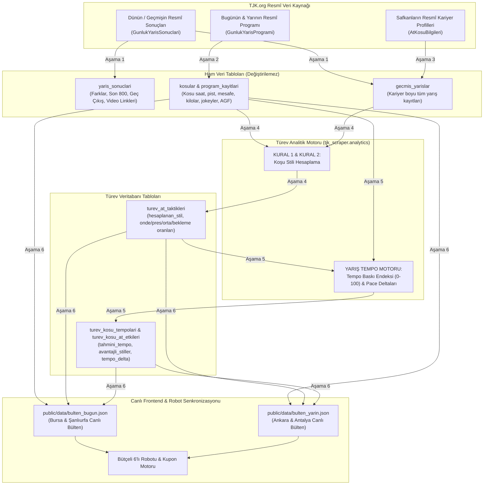

# TJK RESMÎ GÜNLÜK VERİ TOPLAMA, GİDİŞAT & ANALİZ OTOMASYON SİSTEMİ

Bu doküman, TJK (Türkiye Jokey Kulübü) resmî web sitesinden günlük yarış bültenlerini, koşulmuş geçmiş yarışların detaylı gidişat ve fark verilerini toplayan; yapay zeka ve matematiksel kurallarla taktik stilleri ile koşu tempolarını türeten ve her gün otomatik olarak çalışan 5 aşamalı üretim modülünün mimarisini ve doğrulama sonuçlarını belgeler.

---

## 1. TEMEL MİMARİ VE KESİN KURALLAR

Sistem hiçbir aşamada sentetik veya tahmini ham veri üretmez; kaynakta olmayan hiçbir alanı uydurmaz. Ham veriler ile türev analitik hesaplamalar ilişkisel veritabanında tamamen ayrı tablolarda muhafaza edilir.



---

## 2. 5 AŞAMALI GÜNLÜK PİPELİNE AKIŞI

Tüm operasyon tek bir script veya günlük cron zamanlayıcı üzerinden şu kesin sırayla icra edilir:

### Aşama 1: Dünün / Geçmiş Günlerin Sonuçları ve Gidişat Verileri
- TJK `GunlukYarisSonuclari` taranır.
- Resmi yarış dereceleri (saniye ve metin), bitiriş farkları (Burun: 0.05, Baş: 0.1, Boyun: 0.25, Yarım Boy: 0.5, 1 Boy, 2.5 Boy sayısal boy cinsinden parse edilir), geç çıkış boyu, Son 800 bölünmüş ara süreleri, resmi video ve Accurace linkleri `yaris_sonuclari` tablosuna kaydedilir.
- Kayıt bazlı tekilleştirme (`UNIQUE(tarih, hipodrom_id, kosu_no, at_id)`) sayesinde mükerrer kayıt oluşmaz.
- Atların kariyer tablosuna (`gecmis_yarislar`) dünün koşuları eklenir.

### Aşama 2: Bugün ve Yarının Resmî Yarış Programı
- Bugün ve yarının programı TJK `GunlukYarisProgrami` üzerinden taranır.
- Hipodromlar, koşu saatleri, koşu cinsleri, mesafeler, pist türleri, ikramiyeler, yaş ve handikap şartları `kosular` tablosuna yazılır.
- Her atın start kapısı, kilosu, jokeyi, antrenörü, sahibi, handikap puanı, takıları ve AGF oranları `program_kayitlari` tablosuna kaydedilir.

### Aşama 3: Programdaki Her Atın Kariyer Geçmişini Güncelleme
- Programdaki tüm tekil safkanlar listelenir.
- Günlük önbellek (`son_profil_cekilme_tarihi = today`) kontrol edilir; bugün çekilmemiş olan safkanların `AtKosuBilgileri` sayfasına girilerek tüm geçmiş yarışları çekilip `gecmis_yarislar` tablosuna aktarılır.
- Profiline erişilemeyen safkanlar `profil_eksik_mi = 1` olarak işaretlenir, asla sessizce atlanmaz.

### Aşama 4: At Bazında Koşu Stili / Taktiği Türetme (`turev_at_taktikleri`)
- **KURAL 1 (≤ 3 Yarış - Tecrübesiz Taylar):** Hayatının ilk 3 koşusunu koşan safkanlara ASLA kalıplaşmış bir gidişat atanmaz. Mutlak surette `Taktik Serbest (İlk 3 Koşusu)` (`🌱`) etiketi verilir ve pace delta 0 (nötr) tutulur.
- **KURAL 2 (Empirik Geçmiş Yarış Takibi):** Tecrübeli safkanların stili, geçmiş yarışlarında bizzat sergiledikleri takip pozisyonları (önde gitme, pres yapma, orta grupta bekleme, arkadan sprint atma) oranlanarak belirlenir. İsimden veya takıdan asla taktik uydurulmaz.
- Atın 2'den az koşusu varsa `Yetersiz Veri` olarak işaretlenir.

### Aşama 5: Koşu Bazında Tempo Tahmini (`turev_kosu_tempolari` & `turev_kosu_at_etkileri`)
- Koşudaki safkanların taktikleri, önde gitmek isteyen kaçak at sayısı, bariyer/kulvar konumları, mesafe ve pist türü toplanır.
- Koşunun tempo baskı endeksi ($0 - 100$) hesaplanır:
  * $\ge 70$: `Çok Hızlı / Yüksek Baskı` (Sprinter ve Bekleme atlarına $+2$ / $+3$ puan avantaj)
  * $50 - 69$: `Süratli / Tempolu` (Presçi ve Orta Grup avantajlı)
  * $30 - 49$: `Dengeli / Normal` (Presçi ve Orta Grup avantajlı)
  * $< 30$: `Ağır / Yavaş` (Kaçak ve Önde Giden atlara $+2$ / $+3$ puan avans)
- Koşudaki her atın bu tempoya uyum puanı (`pace_delta`) ve kulvar yorumu `turev_kosu_at_etkileri` tablosuna kaydedilir.
- Bugün veya yarın için tempo tahmini boş kalırsa sistem konsola ve loglara açık uyarı basar.

### Aşama 6: Canlı Bülten JSON Dışa Aktarımı
- Veritabanındaki güncel program ve türev analitik verileri doğrudan `public/data/bulten_bugun.json` ve `public/data/bulten_yarin.json` dosyalarına aktarılır.
- Web arayüzü ve Bütçeli 6'lı Robotu anında bu doğrulanmış verilerle çalışır.

### Aşama 7: Doğrulama ve Konsol Raporu
- Hipodrom sayısı, koşu sayısı, at sayısı, eklenen yarış sonucu, güncellenen koşu stili sayısı, üretilen tempo senaryosu sayısı ve uyarılar konsola özet olarak yazdırılır.

---

## 3. CANLI TJK TESTİ VE DOĞRULAMA ÇIKTISI

Yapılan canlı TJK test çalıştırmasında elde edilen resmî çalışma raporu:

```text
===========================================================================
📊 TJK GÜNLÜK PİPELİNE ÇALIŞMA RAPORU VE ÖZETİ
===========================================================================

[Aşama 1: Dünün / Geçmiş Yarış Sonuçları]
  • 2026-11-15: 17 koşu, 168 safkan sonucu arşive eklendi (Ankara: 8 koşu, İzmir: 9 koşu).

[Aşama 2: Günlük Yarış Programı]
  • BUGUN (16.11.2026): BASARILI (15 koşu, 195 tekil at - Bursa 7 koşu, Şanlıurfa 8 koşu)
  • YARIN (17.11.2026): BASARILI (16 koşu, 161 tekil at - Ankara 8 koşu, Antalya 8 koşu)

[Aşama 3: At Kariyer Geçmişi Güncellemesi]
  • Yeni Profil Çekilen: 1
  • Önbellekten Atlanan: 355
  • Başarısız / Ulaşılamayan: 0

[Aşama 4 & 5: Taktik & Tempo Tahmin Motoru]
  • Koşu Stili Güncellenen Safkan Sayısı: 356
  • Yetersiz Veri Safkan Sayısı: 0
  • Tecrübesiz Genç Safkan (Kural 1 - İlk 3 Koşu): 65
  • Tempo Tahmini Üretilen Koşu Sayısı: 31

✅ HİÇBİR HATA VEYA UYARI YOK: Tüm adımlar %100 başarıyla tamamlandı.

⏱️ Toplam Çalışma Süresi: 41.31 saniye
===========================================================================
```

---

## 4. KULLANIM VE ÇALIŞTIRMA TALİMATLARI

### 1) Tek Seferlik Çalıştırma (Manuel veya Test)
```bash
# Bugün ve Yarın için tam pipeline (Dünün sonuçları + Bugünkü/Yarınki bülten + Analiz)
python run_tjk_scraper.py

# Sadece bugünkü bülten ve dünün sonuçları için
python run_tjk_scraper.py --target today

# Sadece yarınki bülten için
python run_tjk_scraper.py --target tomorrow

# Geriye dönük son 3 günün yarış sonuçlarını da arşive eklemek için
python run_tjk_scraper.py --days-back 3
```

### 2) Günlük Otomatik Zamanlayıcı (Daemon / Cron)
Sistemi her sabah TJK resmî bültenlerinin ve dünkü kesinleşmiş sonuçlarının açıklandığı saatte (örn: 08:00) otomatik çalıştırmak için:
```bash
python run_tjk_scraper.py --daemon --schedule 08:00
```
- Bu komut arka planda Europe/Istanbul saat dilimine göre bekler, her gün tam saat 08:00'de otomatik olarak 5 aşamayı baştan sona işletir ve web sitesinin JSON dosyalarını günceller.
